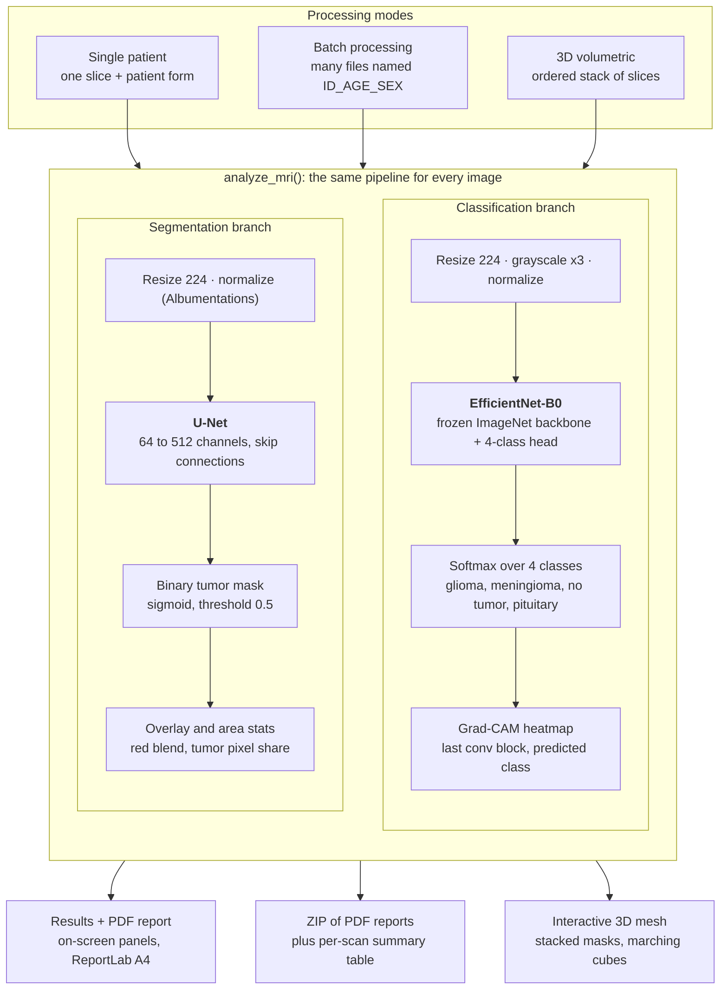

# NeuroScan — Project Documentation

Last updated: 2026-11-14

## Overview

NeuroScan is an end-to-end brain MRI analysis app built with PyTorch and Streamlit. It classifies a scan into one of four classes, explains the decision with Grad-CAM, segments the tumor with a U-Net, and exports a PDF report. On the 1,311-image held-out test set, the classifier reaches 92.45% accuracy (weighted F1 0.924).

It is an academic prototype for research and education in deep learning, computer vision and explainable AI (XAI). It is not a clinical diagnostic tool.

**What it does with an uploaded MRI:**

- **Classifies** the scan as glioma, meningioma, pituitary tumor or no tumor, with a softmax confidence for every class.
- **Explains** the prediction with a Grad-CAM heatmap over the last convolutional block of EfficientNet-B0.
- **Segments** the tumor pixel by pixel with a U-Net trained on image/mask pairs, and overlays the mask on the scan.
- **Measures** the segmented region (tumor pixel area and share of the image).
- **Reports** everything in a downloadable PDF with images, scores and a medical disclaimer.
- **Scales up** with batch processing of many images and volumetric processing of a stack of slices into a 3D view.

**Tech stack:** Python 3.12, PyTorch / torchvision, pytorch-grad-cam, Albumentations, OpenCV, scikit-learn, scikit-image, Streamlit, Plotly, ReportLab. Runs on CUDA GPU or CPU.

## System architecture

NeuroScan is a single Streamlit process that loads both trained models once (cached) from `saved_models/` and routes every image through one function, `analyze_mri()`. The classification and segmentation branches run independently on the same image; only the outputs are combined.



The two bold boxes are the trained networks. Grad-CAM reuses the classifier's gradients, and the mode chosen at the top only decides how the per-image results are packaged at the bottom.

## Models and ML pipeline

Two independently trained networks share one 224×224 input: a transfer-learned EfficientNet-B0 for classification and a U-Net trained from scratch for binary segmentation. Grad-CAM adds explainability on top of the classifier without extra training.

### 1. Classifier: EfficientNet-B0 (transfer learning)

| Setting | Value |
| --- | --- |
| Backbone | torchvision `efficientnet_b0`, ImageNet weights (`EfficientNet_B0_Weights.DEFAULT`) |
| Fine-tuning strategy | Feature extractor frozen; only the new head is trained |
| Head | Dropout(0.2) → Linear(1280 → 4) |
| Classes | glioma, meningioma, no tumor, pituitary |
| Input preprocessing | Resize 224×224 → grayscale replicated to 3 channels → ImageNet mean/std normalization |
| Augmentation | None |
| Loss / optimizer | Cross-entropy / Adam, learning rate 0.01, batch size 32 |
| Schedule | Up to 10 epochs, early stopping with patience 3 on test accuracy |
| Seed | 42, cuDNN deterministic |
| Checkpoint | `saved_models/efficientnet_brain_tumor_best.pth` (state dict) |

The dataset is laid out as `dataset/classification/{Training,Testing}/<class>/` and loaded with torchvision `ImageFolder`. The test split has 1,311 images (300 glioma, 306 meningioma, 405 no tumor, 300 pituitary), which matches the public Kaggle *Brain Tumor MRI Dataset*; confirm the exact source before citing it.

**Results on the 1,311-image test set** (`classifier/evaluate.py`, saved in `model_assessment.txt`): accuracy 92.45%, weighted precision 0.925, recall 0.925, F1 0.924.

| Class | Precision | Recall | F1 | Test images |
| --- | --- | --- | --- | --- |
| No tumor | 0.96 | 0.99 | 0.98 | 405 |
| Pituitary | 0.93 | 0.98 | 0.96 | 300 |
| Glioma | 0.95 | 0.84 | 0.89 | 300 |
| Meningioma | 0.84 | 0.86 | 0.85 | 306 |

Confusion matrix (rows = true class, columns = predicted):

| True ↓ / Predicted → | Glioma | Meningioma | No tumor | Pituitary |
| --- | --- | --- | --- | --- |
| Glioma | 252 | 43 | 0 | 5 |
| Meningioma | 11 | 263 | 16 | 16 |
| No tumor | 1 | 2 | 402 | 0 |
| Pituitary | 0 | 4 | 1 | 295 |

The main error is glioma predicted as meningioma (43 of 300 gliomas). Healthy scans are almost never flagged as tumors (3 of 405).

### 2. Explainability: Grad-CAM

`classifier/gradcam.py` wraps `pytorch-grad-cam`. It targets `model.features[-1]`, the last convolutional block of EfficientNet-B0, and explains the predicted class. The app re-enables gradients on that block (the rest stays frozen) and blends the heatmap over the scan with a user-set opacity (0.1–1.0).

### 3. Segmentation: U-Net (trained from scratch)

| Setting | Value |
| --- | --- |
| Architecture | Classic U-Net: 4 encoder levels (64, 128, 256, 512 channels), 1,024-channel bottleneck, 4 decoder levels with skip connections, 1×1 output conv |
| Building block | DoubleConv = (Conv3×3 → BatchNorm → ReLU) × 2; MaxPool down, ConvTranspose2d up |
| Output | 1 channel of logits → sigmoid → threshold 0.5 → binary mask |
| Initialization | Kaiming (He) normal, fan-out |
| Data | `dataset/segmentation/<class>/` with `name.png` + `name_mask.png` pairs for glioma, meningioma, pituitary |
| Split | 80% train / 20% validation, seeded random permutation (seed 42) |
| Augmentation (train) | Resize 224, horizontal flip (p 0.5), vertical flip (p 0.2), rotate ±15° (p 0.5), ImageNet normalization (Albumentations) |
| Loss | 0.5 × BCE-with-logits + 0.5 × soft Dice loss |
| Optimizer | Adam, learning rate 1e-4 (weight decay 1e-5 is set in config but not passed to Adam) |
| Schedule | Up to 30 epochs, ReduceLROnPlateau on validation loss (factor 0.5, patience 2), early stopping with patience 5 on validation Dice |
| Batch size | 8 |
| Checkpoint | `saved_models/best_unet.pth` (dict with model, optimizer and scheduler state plus metrics) |

The training loss combines pixel-wise BCE with a soft Dice term, which handles the strong imbalance between small tumor regions and background:

```math
\mathcal{L} = 0.5\,\mathrm{BCE}(\hat{y}, y) + 0.5\left(1 - \frac{2\sum \sigma(\hat{y})\, y + \epsilon}{\sum \sigma(\hat{y}) + \sum y + \epsilon}\right)
```

The reported metric is the hard Dice coefficient on the thresholded mask. The best validation Dice is stored inside the checkpoint but is not written to the repository; it should be added to this document.

## Features and processing modes

The Streamlit app offers three modes from one selector: Single Patient, Batch Processing and 3D Volumetric. All three reuse the same `analyze_mri()` function, so every image goes through the identical pipeline.

### Per-image analysis (`analyze_mri`)

1. Preprocess the image twice: torchvision transform for the classifier, Albumentations transform for the U-Net.
2. Classify and apply softmax to get the probability of each of the 4 classes.
3. Segment with the U-Net and threshold the sigmoid output at 0.5.
4. Blend the mask in red over the resized scan (opacity = the sidebar slider).
5. Count tumor pixels and their share of the 224×224 image.
6. Generate the Grad-CAM overlay for the predicted class.
7. Save original, Grad-CAM, mask and overlay PNGs to a per-patient temp folder for the report.

Models load once per server process through `@st.cache_resource`.

### Processing modes

| Mode | Input | Output |
| --- | --- | --- |
| Single Patient | Patient ID, age, sex, scan date + one JPG/PNG slice | Diagnosis banner, class probability bars, Grad-CAM, mask, overlay, tumor area stats, PDF report download |
| Batch Processing | Many JPG/PNG files named `PATIENTID_AGE_SEX` (e.g. `NS001_24_Male.png`, `NS003_31_M.png`) + a report date | Validation table (Ready / Invalid with reason), per-scan summary table, one PDF per patient bundled in `NeuroScan_Batch_Reports.zip` |
| 3D Volumetric | An ordered stack of slices from one patient + a Z-spacing multiplier (1–6, default 3) | Volume-level diagnosis, averaged class probabilities, total tumor voxel share, slice ranking, interactive 3D mesh of tumor and skull outline |

### How 3D volumetric reconstruction works

- Slices are sorted in natural order by filename (`slice_2` before `slice_10`).
- Each slice runs through `analyze_mri()`. Slices predicted as a tumor class are "pertinent".
- The volume diagnosis is the arg-max of the class probabilities averaged over pertinent slices only.
- Slices are ranked by their probability for that class, then by tumor pixel count.
- The 2D masks are stacked into a 3D array and meshed with scikit-image `marching_cubes`. A brain outline from an OpenCV threshold (> 15) and contour pass is meshed the same way as a translucent envelope.
- Plotly `Mesh3d` renders both meshes in an interactive, rotatable view.

### PDF report (`streamlit_app/pdf_report.py`)

Built with ReportLab on A4. Each report has a letterhead with a unique reference (`NS-YYYYMMDD-HHMMSS`), then Patient, Findings (predicted class, confidence, tumor area and pixel counts) and Imaging (original, Grad-CAM, mask, overlay) sections, plus a medical disclaimer footer.

### Interface

Light and dark themes are defined in `.streamlit/config.toml` (Inter font). The app follows the viewer's system setting by default, and the System / Light / Dark switch sits in the top-right (⋮) menu. A component layer in `streamlit_app/ui.py` (cards, banners, probability bars, image grids, 3D figure styling) derives its colors from the active theme, so custom components switch together with Streamlit's own widgets. The sidebar holds the Grad-CAM intensity slider, model stack badges, detectable classes, the team credit and a note on switching themes.

## Repository structure

The code splits into two self-contained ML packages (`classifier/`, `segmentation/`), the web app (`streamlit_app/`) and a model downloader (`utils/`). Datasets and trained weights are git-ignored.

| Path | Purpose |
| --- | --- |
| `classifier/config.py` | Paths, device, image size, class names, hyperparameters |
| `classifier/dataset.py` | `ImageFolder` loading, transforms, DataLoaders |
| `classifier/model.py` | EfficientNet-B0 creation, freezing, new 4-class head |
| `classifier/train.py` | Training loop with early stopping and checkpointing |
| `classifier/evaluate.py` | Accuracy, precision, recall, F1, classification report, confusion matrix |
| `classifier/gradcam.py` | `GradCAMGenerator` wrapper around pytorch-grad-cam |
| `classifier/utils.py` | Seeding, checkpoint save/load, accuracy, `AverageMeter` |
| `segmentation/config.py` | Paths, U-Net channels, loss weights, thresholds, training settings |
| `segmentation/dataset.py` | Image/mask pair dataset, Albumentations transforms, 80/20 split |
| `segmentation/model.py` | U-Net (`DoubleConv`, `Down`, `Up`), Kaiming init, parameter count |
| `segmentation/train.py` | Dice and BCE+Dice losses, training loop, LR scheduler, checkpoints |
| `segmentation/test_model.py` | Standalone inference and matplotlib visualization on one image |
| `streamlit_app/app.py` | Main app: model loading, `analyze_mri()`, single, batch and 3D modes |
| `streamlit_app/ui.py` | Theme-aware styling and reusable UI components |
| `streamlit_app/pdf_report.py` | ReportLab PDF report generator |
| `utils/download_models.py` | Downloads both trained checkpoints from Hugging Face |
| `.streamlit/config.toml` | Light and dark app themes |
| `docs/DOCUMENTATION.md` | This document |
| `model_assessment.txt` | Saved classifier evaluation output |
| `test.py` | Earlier, simpler version of the Streamlit app |
| `dataset/` | `classification/{Training,Testing}/<class>/` and `segmentation/<class>/` (not in git) |
| `saved_models/` | Trained `.pth` checkpoints (not in git) |
| `assets/` | Logo, screenshots, sample PDF report, demo video |

## Setup and running

The app needs Python 3.12 (the version the project was built with), the packages in `requirements.txt` and the two trained checkpoints. Run every command from the repository root: the app and downloader use paths relative to it (`assets/logo.png`, `saved_models/`).

### Run the app with pre-trained models

```bash
git clone https://github.com/singularity-sans-null/NeuroScan-Clone.git
cd NeuroScan-Clone
python -m venv .venv
source .venv/bin/activate        # Windows: .venv\Scripts\activate
pip install -r requirements.txt

# Download efficientnet_brain_tumor_best.pth and best_unet.pth
# from huggingface.co/Ayoola-In/Neuroscan-models into saved_models/
python -m utils.download_models

streamlit run streamlit_app/app.py
```

The app opens at `http://localhost:8501` and uses a CUDA GPU when one is available, otherwise the CPU. The model download is not triggered by the app itself, so run it once before the first launch.

### Retrain the models

1. Place the classification data in `dataset/classification/Training/<class>/` and `dataset/classification/Testing/<class>/`.
2. Place segmentation pairs in `dataset/segmentation/<class>/` as `name.png` + `name_mask.png`.
3. Train and evaluate the classifier: `python -m classifier.train`, then `python -m classifier.evaluate`.
4. Sanity-check and train the U-Net: `python -m segmentation.model` (prints a shape test), then `python -m segmentation.train`.

Checkpoints land in `saved_models/`. Hyperparameters live in each package's `config.py`.

## Limitations, disclaimer and future work

NeuroScan is a research and teaching prototype. It has not been clinically validated, and every output must be reviewed by a qualified clinician. The points below are known gaps an ML reviewer should weigh when reading the results.

### Known limitations

| Area | Limitation | Effect |
| --- | --- | --- |
| Evaluation | The classifier's early stopping and best-checkpoint choice use the Testing split, which is also the split reported | The 92.45% accuracy is likely optimistic; there is no untouched hold-out set |
| Classifier training | Frozen backbone, no augmentation, learning rate 0.01 | Leaves accuracy on the table, especially for glioma vs meningioma |
| Segmentation metrics | Validation Dice is kept only inside the checkpoint | No published segmentation score yet |
| Segmentation scope | The U-Net was trained only on tumor images, but runs on every image | It can draw false-positive masks on healthy scans |
| Config | `WEIGHT_DECAY` is defined but not passed to the optimizer | No L2 regularization in U-Net training |
| 3D mode | Slice-by-slice 2D inference; Z spacing is a manual multiplier, not scanner metadata | The mesh is a visualization, not a calibrated volume |
| Units | Tumor size is in pixels at 224×224 | No physical size (mm² or cm³) |
| Input formats | JPG/PNG only | No DICOM or NIfTI support |
| Batch metadata | Patient data is parsed from `PATIENTID_AGE_SEX` filenames | Mis-named files are rejected |

### Future work

- Add a separate validation split and report test metrics once, on untouched data.
- Unfreeze and fine-tune the backbone with augmentation and a lower learning rate.
- Publish U-Net Dice and IoU on a held-out set.
- Gate segmentation on the classifier result, or train the U-Net with healthy images as negatives.
- Read DICOM/NIfTI with real voxel spacing to report tumor volume in cm³.
- Move to 3D or 2.5D models (e.g. BraTS-style multi-sequence input).
- Add calibration and uncertainty estimates for the confidence scores.
- Add automated tests and a containerised deployment.
